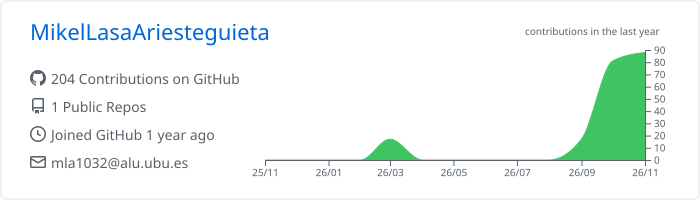
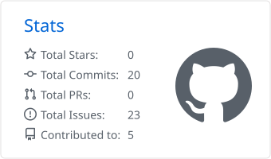
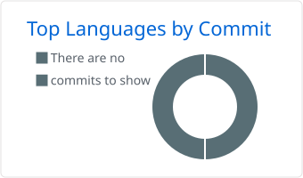

**Estudiante de Ingeniería de la Salud · Universidad de Burgos**

---

## Sobre mí

Soy estudiante de 3º de Ingeniería de la Salud en la Universidad de Burgos (UBU). Me interesa aplicar la programación y la inteligencia artificial a problemas del ámbito sanitario: gestión de pacientes, logística hospitalaria y sistemas de apoyo a la decisión clínica.

Trabajo sobre todo con **Python**, y también uso **R** para análisis y visualización de datos. En mis proyectos intento seguir buenas prácticas: código organizado en paquetes, pruebas automáticas, control de versiones con ramas e issues y documentación clara.

## Proyectos

### 🏥 Análisis clínicos para médicos especialistas

Sistema para gestionar los resultados de análisis clínicos y ponerlos a disposición de los médicos especialistas de forma rápida y segura. Proyecto en equipo organizado en 4 sprints: modelo de datos y persistencia, autenticación y autorización por roles (RBAC), flujo de laboratorio, publicación de resultados, seguridad y auditoría.

### 🩺 Gestor de pacientes

Programa de consola para gestionar la lista de espera de un hospital. Atiende a los pacientes por prioridad (y por orden de llegada en caso de empate), guarda historial y estadísticas, y mantiene los datos en JSON entre ejecuciones. Estructurado como paquete instalable, con pruebas en pytest y desarrollo por ramas e issues.

### 🗺️ Planificación de rutas hospitalarias

Búsqueda de rutas dentro de un hospital comparando algoritmos de búsqueda (anchura, profundidad, coste uniforme, voraz y A\*). Incluye la planificación de los recorridos de un robot que recoge muestras y entrega resultados, con visualización de las rutas en Streamlit.

### 🧠 Sistema de apoyo a la decisión clínica con perceptrón

Comparación de dos sistemas de apoyo a la decisión clínica (CDS) que proponen la patología de 1000 pacientes: uno basado en reglas con pesos definidos a mano y otro basado en aprendizaje automático con perceptrones y un perceptrón multicapa (MLP).

### 📊 Fundamentos de datos en R

Prácticas de la asignatura de fundamentos de datos: objetos y funciones en R, importación y exportación de datos, visualización con ggplot2, consultas RDF/SPARQL y búsquedas en PubMed. Documentado con R Markdown.

## Tecnologías

  

| Área | Herramientas |
|---|---|
| Lenguajes | Python, R |
| Datos e IA | NumPy, pandas, Matplotlib, scikit-learn, ggplot2 |
| Desarrollo | pytest, Jupyter, Streamlit, R Markdown |
| Trabajo en equipo | Git, GitHub (ramas, issues, pull requests), Scrum |

## Estadísticas de GitHub

## Actividad

## Contribuciones

<picture>
  <source media="(prefers-color-scheme: dark)" srcset="https://raw.githubusercontent.com/MikelLasaAriesteguieta/MikelLasaAriesteguieta/output/github-snake-dark.svg" />
  
</picture>

## Contacto

  
  <!-- Añade aquí tu LinkedIn cuando lo tengas:
  
  -->

